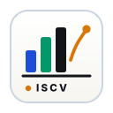
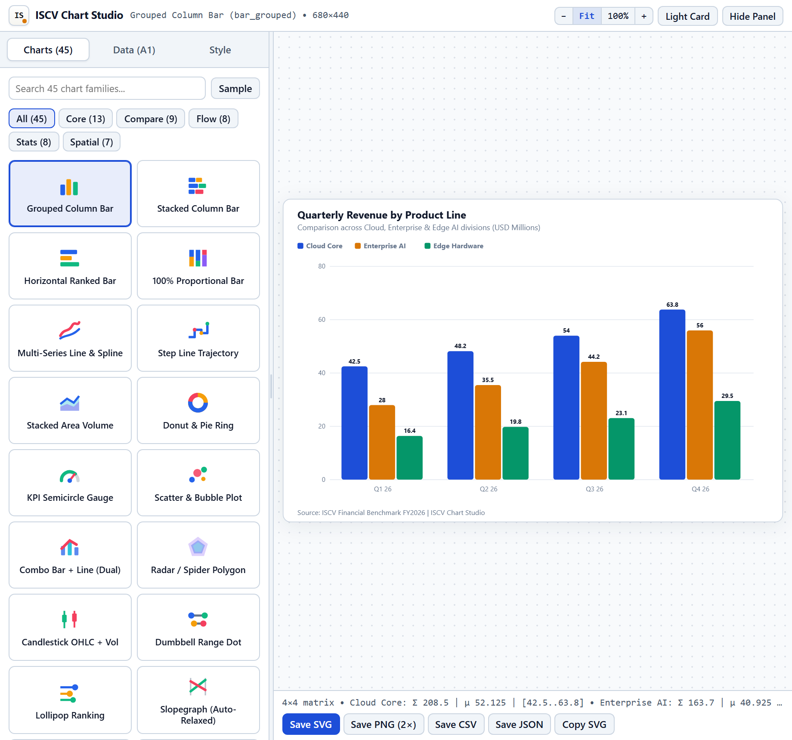
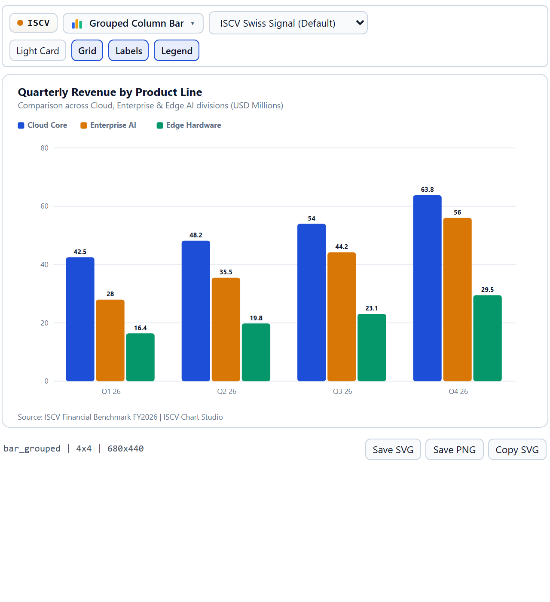
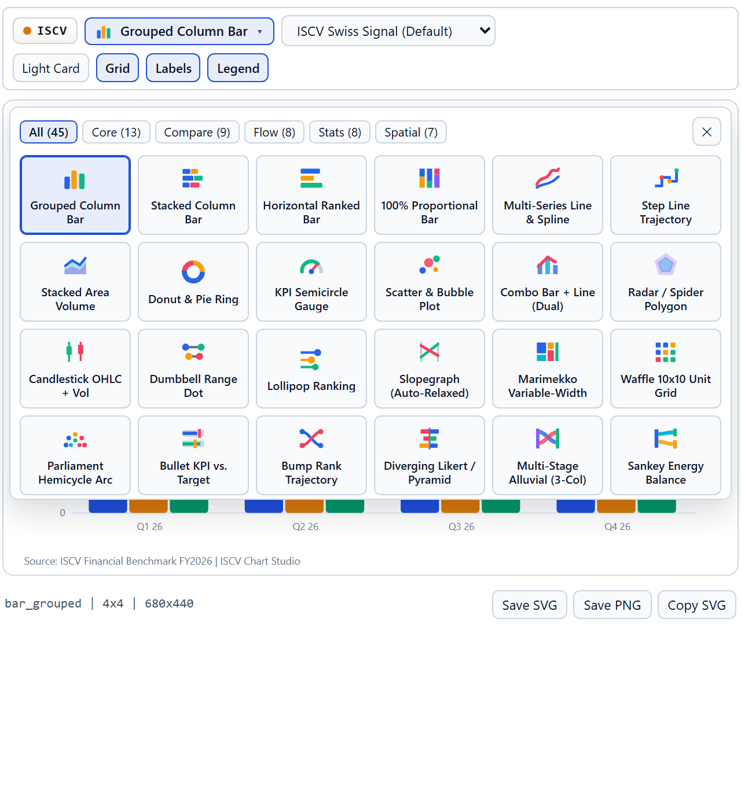
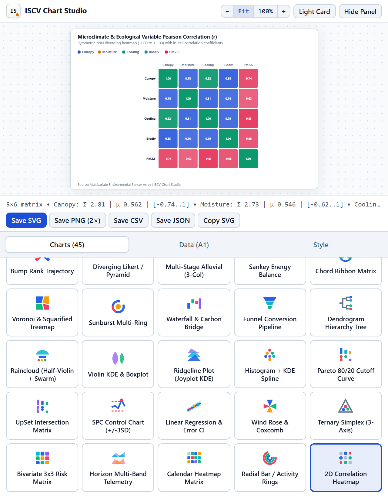
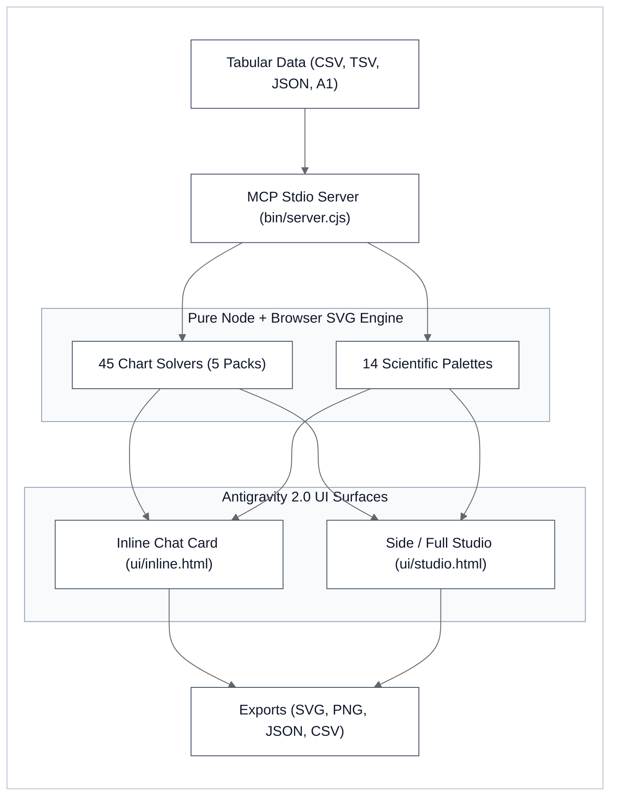
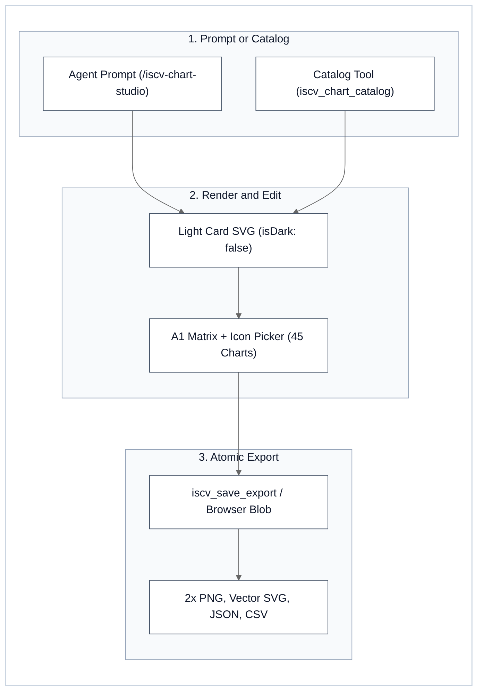

<div align="center">
  
  <h1>ISCV Chart Studio</h1>
  <p><strong>Offline 45-family SVG chart studio for Antigravity 2.0 inline chat, side panel &amp; full-page views with A1 matrix editing, 14 palettes &amp; SVG/PNG/CSV export.</strong></p>

  <p>
    
    
    
    
    
  </p>
</div>

**ISCV Chart Studio** turns raw CSV, TSV, JSON, or A1 spreadsheet ranges into interactive, Light-first Archival Paper (`#FFFFFF`) scientific charts directly inside **Antigravity 2.0**—replacing external SaaS chart builders and static screenshots with offline, zero-CDN pure SVG rendering, a live A1 spreadsheet editor, and multi-format export (`SVG`, `2× PNG`, `RFC-4180 CSV`, `JSON`).

<p align="center">
  
</p>

| Inline Chat Card (Light Default) | Inline 45-Family Visual Icon Picker | Compact Side-Panel Stack &amp; Tiles |
| :---: | :---: | :---: |
|  |  |  |

---

## ⚡ TL;DR — Capabilities & Verified Receipts

- **45 Scientific & Statistical Chart Families (`5` Packs)**: Covers Core Essentials (`13`), Compare & Unit Grids (`9`), Flow & Hierarchy (`8`), Statistical Lab (`8`, including Raincloud KDE+Swarm, Violin, Ridgeline, UpSet, SPC `±3SD`, OLS+`95%` CI), and Polar, Spatial & Telemetry (`7`, including Wind Rose, Ternary Simplex, Bivariate `3×3`, Pearson Correlation).
- **14 Commercial-Safe Palettes & Light-First Default (`isDark: false`)**: Defaults to Archival Paper Light Cards (`#FFFFFF`) with `ISCV Swiss Signal`, alongside Okabe-Ito, Crameri Batlow/Vik, ColorBrewer, Viridis, Plasma, and 2 Bivariate `3×3` matrices (`0` trademarked swatches; optional dark card via `isDark: true`).
- **Dual Antigravity 2.0 MCP App Surfaces**: Renders compact interactive cards directly in chat (`iscv_plot_inline`) and opens a responsive split-pane studio (`iscv_open_studio` via `aux_pane` and `global` sidebar) featuring a live A1 matrix editor, Fit/`100%` zoom controls, and `SVG` / `2× PNG` / `RFC-4180 CSV` / `JSON` exports.
- **Zero-Dependency Runtime Bundles (`6.28%–6.48%` of `10 MiB` Cap)**: Compiles into `bin/server.cjs` (`1,630.21 KiB`), `ui/inline.html` (`642.76 KiB`), and `ui/studio.html` (`663.32 KiB`) with `0` external CDNs, `0` Figma coupling, and `0` `node_modules` required at plugin runtime.
- **Off-Trajectory Large Dataset Staging & Verified E2E Suite**: Automatically offloads payloads exceeding `800 KB` via `iscv_load_dataset` (`12,000`-row smoke test verified `< 1 MiB` response); `45/45` SVG renders and `18/18` Playwright viewport × tab checks pass with `0` errors.

### One-Prompt Universal Agent Install

Compatible with **Any AI Agent (Cloud • IDE • CLI • Local LLM)**—paste this prompt into your agent or run the single Antigravity CLI command below:

```text
Install the ISCV Chart Studio Antigravity plugin from https://github.com/iscvlab/iscv-chart-studio:
1. If the `agy` CLI is available, run `agy plugin install https://github.com/iscvlab/iscv-chart-studio` and verify with `agy plugin validate --strict` and `agy plugin list --json`.
2. Otherwise, detect my OS and global plugin directory (`~/.gemini/config/plugins/iscv-chart-studio` on Linux/macOS or `%USERPROFILE%\.gemini\config\plugins\iscv-chart-studio` on Windows), clone `https://github.com/iscvlab/iscv-chart-studio` there (runtime bundles require zero `node_modules`), and verify `node bin/server.cjs` + `npm test` pass.
```

```bash
agy plugin install https://github.com/iscvlab/iscv-chart-studio
```

### Verified Bundle Footprint & Capability Comparison

| Evaluation Dimension | Artifact / Component | Visual Bar (`20-Block`) | Measured Result & Spec Receipt |
| :--- | :--- | :--- | :--- |
| **1. UI Bundle Size vs. `10 MiB` Limit ↓**<br>*(Lower = Better)* | **`ui/inline.html`**<br>**`ui/studio.html`**<br>`bin/server.cjs`<br>`10 MiB` MCP App Cap | `█░░░░░░░░░░░░░░░░░░░` **`6.28%`**<br>`█░░░░░░░░░░░░░░░░░░░` **`6.48%`**<br>`███░░░░░░░░░░░░░░░░░` `15.92%`<br>`████████████████████` `100.0%` | **`642.76 KiB`** (`658,185 B`, `0` CDN)<br>**`663.32 KiB`** (`679,242 B`, `0` CDN)<br>`1,630.21 KiB` (`1,669,331 B`, standalone)<br>`10,240.00 KiB` (Host limit) |
| **2. Chart Coverage (`45` Families) ↑** | **Full 5-Pack Suite**<br>`pack0` Core Essentials<br>`pack1` Compare & Grids<br>`pack2` Flow / `pack3` Stats<br>`pack4` Polar & Spatial | `████████████████████` **`100.0%`**<br>`██████░░░░░░░░░░░░░░` `28.9%`<br>`████░░░░░░░░░░░░░░░░` `20.0%`<br>`████░░░░░░░░░░░░░░░░` `17.8%`<br>`███░░░░░░░░░░░░░░░░░` `15.6%` | **`45 / 45` Families** (`0` NaN/Infinity)<br>`13` Generalist charts<br>`9` Executive & unit charts<br>`8` Flow + `8` Statistical charts<br>`7` Polar, ternary & matrix charts |
| **3. Palette Distribution (`14` Total) ↑** | **Full Palette Catalog**<br>Sequential & Diverging<br>ISCV Signature Series<br>Colorblind-Safe<br>Bivariate `3×3` Matrices | `████████████████████` **`100.0%`**<br>`███████░░░░░░░░░░░░░` `35.7%`<br>`██████░░░░░░░░░░░░░░` `28.6%`<br>`████░░░░░░░░░░░░░░░░` `21.4%`<br>`███░░░░░░░░░░░░░░░░░` `14.3%` | **`14 / 14` Palettes** (Light + Dark ramps)<br>`5` Brewer, Viridis & Plasma<br>`4` First-party `@iscvlab` ramps<br>`3` Okabe-Ito, Batlow & Vik<br>`2` Stevens & ISCV Teal-Amber |
| **4. Automated Verification Gates ↑** | **`npm test` (Unit + E2E)**<br>**`test_visual_qa.py`**<br>**`agy plugin validate`** | `████████████████████` **`100.0%`**<br>`████████████████████` **`100.0%`**<br>`████████████████████` **`100.0%`** | **`45/45` SVGs + Live Stdio PASS**<br>**`18/18` (`6` viewports × `3` tabs, `0` errors)**<br>**`0` Errors / `0` Warnings (`--strict`)** |

---

## 1. Architecture & Surface Workflow

ISCV Chart Studio runs a zero-dependency Node.js stdio MCP server (`bin/server.cjs`) paired with two CSP-hardened single-file HTML applications (`ui/inline.html` and `ui/studio.html`). Every chart solver in `src/core/` executes identically in Node.js (for `iscv_save_export` and headless tests) and inside the browser UI (for live A1 editing, instant chart switching, and hover tooltips).



When invoked via an agent prompt or sidebar entrypoint, inputs pass through `normalizeChartSpec` (`isDark: false` Light Card default, explicit metadata discipline on custom `rawData`/`rows` so sample preset captions never leak), and payloads larger than `800 KB` automatically stage into `${PLUGIN_DATA}/cache/` for lazy hydration via `iscv_load_dataset`.



---

## 2. Quick Start & Installation

> **Antigravity Marketplace Status**: **`IN PIPELINE`** *(Partner intake submitted `2026-11-26`; validated with `agy plugin validate --strict`; pending official Antigravity Marketplace review. Install directly from GitHub or a local clone using the commands below.)*

### Option A — Direct GitHub Install (Antigravity CLI)

```bash
agy plugin install https://github.com/iscvlab/iscv-chart-studio
agy plugin list --json
```

### Option B — Local Clone & Validation

```bash
git clone https://github.com/iscvlab/iscv-chart-studio.git
cd iscv-chart-studio
agy plugin validate --strict .
agy plugin install .
```

For manual global installation without `npm install`, copy the flat plugin runtime files (`plugin.json`, `mcp_config.json`, `LICENSE`, `README.md`, `assets/`, `skills/`, `bin/`, `ui/`) directly into `~/.gemini/config/plugins/iscv-chart-studio` (macOS/Linux) or `%USERPROFILE%\.gemini\config\plugins\iscv-chart-studio` (Windows). No `node_modules` folder is needed at runtime.

### Prompt Examples (`/iscv-chart-studio`)

Invoke the bundled [`/iscv-chart-studio`](skills/iscv-chart-studio/SKILL.md) skill or use natural prompts in Antigravity chat:

- *"Plot a grouped column bar chart inline comparing Q1-Q4 revenue by product line"*
- *"Open ISCV Chart Studio in the side panel with a Raincloud distribution dataset"*
- *"List all 45 ISCV chart families and 14 scientific palettes"*
- *"Use `/iscv-chart-studio` to render this CSV as a Sankey diagram with the `okabe_ito_universal` palette and explicit title, subtitle, and source."*

---

## 3. MCP Tools, 45 Chart Families & 14 Palettes

### Surface Summary — MCP Tools (`iscv-chart-studio_charts`)

| # & Tool Name | Visibility & Surfaces | Key Parameters | Returned Payload / Output |
| :--- | :--- | :--- | :--- |
| **1. `iscv_plot_inline`** | Model + App (`inline.html`) | `chartId`, `rawData` / `rows`, `title`, `paletteId`, `isDark` | Light-default inline SVG card + `summary` + optional `saveSvgPath` |
| **2. `iscv_open_studio`** | Model + App (`aux_pane`, `global`) | Same chart spec schema + `cardWidth`, `cardHeight` | Full studio workbench (`studio.html`) with A1 grid & SVG/PNG/CSV/JSON export |
| **3. `iscv_chart_catalog`** | Model + App (`readOnlyHint`) | `packId` (`pack0`..`pack4`), `query` | All `45` chart IDs, headers & `14` palette definitions |
| **4. `iscv_save_export`** | App-only UI export bridge | `format` (`svg`, `png`, `json`, `csv`), `spec`, `pngBase64` | Atomic file write to `${PLUGIN_DATA}/exports` + `fileUri` |
| **5. `iscv_load_dataset`** | App-only (`readOnlyHint`) | `datasetToken` (`ds_*`) | Hydrates cached datasets exceeding `800 KB` off-trajectory |

### Surface Summary — 5 Chart Packs (`45` Families)

| # & Pack ID | Focus Domain | Representative `chartId` Values | Typical Input Shape |
| :--- | :--- | :--- | :--- |
| **1. `pack0` (`13`)** | Core Essentials | `bar_grouped`, `line_smooth`, `pie_donut`, `candlestick_ohlc` | Category/Time + `1..N` series (or OHLC+Vol) |
| **2. `pack1` (`9`)** | Compare & Unit Grids | `dumbbell_range`, `lollipop_rank`, `waffle_parliament`, `bullet_target` | Paired metrics, ranks, shares, or KPI targets |
| **3. `pack2` (`8`)** | Flow & Hierarchy | `alluvial_multistage`, `sankey_flow`, `voronoi_treemap`, `waterfall_bridge` | Source -> Target (+ Stage) + weight/delta |
| **4. `pack3` (`8`)** | Statistical Lab | `raincloud_plot`, `ridgeline_joyplot`, `upset_matrix`, `spc_control` | Replicate samples, set flags, or ±SD series |
| **5. `pack4` (`7`)** | Polar, Spatial & Matrix | `windrose_coxcomb`, `ternary_simplex`, `calendar_heatmap`, `correlation_matrix` | Compass bins, `A+B+C=100%`, or `N×N` matrix |

<details>
<summary><strong>Full MCP Tool Schemas &amp; UI Resource Contracts (5 Tools, 2 UI Resources)</strong></summary>

- **MCP UI Resources (`text/html;profile=mcp-app`)**:
  - `ui://iscv-chart-studio/inline.html` — Inline chat card (`prefersBorder: false`, strict empty CSP `connectDomains/resourceDomains/frameDomains/baseUriDomains: []`).
  - `ui://iscv-chart-studio/studio.html` — Side-panel (`aux_pane`) and full-page (`global`) studio workbench (`prefersBorder: false`, strict empty CSP).
- **Shared Plotting Parameters (`iscv_plot_inline` / `iscv_open_studio`)**:
  - `chartId`: One of the `45` ISCV chart IDs (defaults to `bar_grouped`).
  - `headers`, `rows`, `rawData`, `range`: 2D array rows, array of objects, or raw CSV/TSV/JSON string with optional spreadsheet A1 slice (`"A1:D10"`).
  - `title`, `subtitle`, `source`: Explicit chart captions. On custom `rawData`/`rows`, omitted `subtitle` defaults to `""` and omitted `source` defaults to `"ISCV Chart Studio"` (preventing sample preset text leaks).
  - `paletteId`: One of the `14` palette IDs (defaults to `iscv_swiss_signal`).
  - `isDark`: Boolean card theme (defaults to `false` for Light Card `#FFFFFF`; set `true` for `#0B0F19` Dark Card).
  - `cardWidth` (`320..2400`, default `680`), `cardHeight` (`220..1600`, default `440`), `showHeader`, `showLegend`, `showGrid`, `showLabels`, `diagonalLabels`, `showFooter`, `saveSvgPath`.
- **Export & Staging Tools**:
  - `iscv_save_export`: Writes `.svg`, `.png` (base64 up to `10 MiB`), `.json` (normalized spec), or RFC-4180 `.csv` atomically via temp-file + rename into `--data-dir` / `${PLUGIN_DATA}/exports` (or `outputDir`).
  - `iscv_load_dataset`: Reads `${PLUGIN_DATA}/cache/<token>.json` when `buildChartPayload` exceeds `MAX_TRAJECTORY_BYTES` (`800,000` bytes).

</details>

<details>
<summary><strong>Complete 45 Chart Families Registry (All 5 Packs)</strong></summary>

1. **`pack0` — Core Essentials (`13`)**:
   `bar_grouped` (Grouped Column Bar) • `bar_stacked` (Stacked Column Bar) • `bar_horizontal` (Horizontal Ranked Bar) • `bar_stacked_100` (100% Proportional Bar) • `line_smooth` (Multi-Series Line & Spline) • `line_step` (Step Line Trajectory) • `area_stacked` (Stacked Area Volume) • `pie_donut` (Donut & Pie Ring) • `gauge_kpi` (KPI Semicircle Gauge) • `scatter_bubble` (Scatter & Bubble Plot) • `combo_dual` (Combo Bar + Line (Dual)) • `radar_polygon` (Radar / Spider Polygon) • `candlestick_ohlc` (Candlestick OHLC + Vol)
2. **`pack1` — Compare & Unit Grids (`9`)**:
   `dumbbell_range` (Dumbbell Range Dot) • `lollipop_rank` (Lollipop Ranking) • `slopegraph_tufte` (Slopegraph (Auto-Relaxed)) • `marimekko_bars` (Marimekko Variable-Width) • `waffle_parliament` (Waffle 10x10 Unit Grid) • `parliament_arc` (Parliament Hemicycle Arc) • `bullet_target` (Bullet KPI vs. Target) • `bump_ranking` (Bump Rank Trajectory) • `diverging_bar` (Diverging Likert / Pyramid)
3. **`pack2` — Flow & Hierarchy (`8`)**:
   `alluvial_multistage` (Multi-Stage Alluvial (3-Col)) • `sankey_flow` (Sankey Energy Balance) • `chord_ribbon` (Chord Ribbon Matrix) • `voronoi_treemap` (Voronoi & Squarified Treemap) • `sunburst_pack` (Sunburst Multi-Ring) • `waterfall_bridge` (Waterfall & Carbon Bridge) • `funnel_conversion` (Funnel Conversion Pipeline) • `dendrogram_tree` (Dendrogram Hierarchy Tree)
4. **`pack3` — Statistical Lab (`8`)**:
   `raincloud_plot` (Raincloud (Half-Violin + Swarm)) • `violin_boxplot` (Violin KDE & Boxplot) • `ridgeline_joyplot` (Ridgeline Plot (Joyplot KDE)) • `beeswarm_kde` (Histogram + KDE Spline) • `upset_pareto_spc` (Pareto 80/20 Cutoff Curve) • `upset_matrix` (UpSet Intersection Matrix) • `spc_control` (SPC Control Chart (+/-3SD)) • `regression_ci` (Linear Regression & Error CI)
5. **`pack4` — Polar, Spatial & Telemetry (`7`)**:
   `windrose_coxcomb` (Wind Rose & Coxcomb) • `ternary_simplex` (Ternary Simplex (3-Axis)) • `horizon_bivariate_calendar` (Bivariate 3x3 Risk Matrix) • `horizon_band` (Horizon Multi-Band Telemetry) • `calendar_heatmap` (Calendar Heatmap Matrix) • `radial_bar` (Radial Bar / Activity Rings) • `correlation_matrix` (2D Correlation Heatmap)

</details>

<details>
<summary><strong>All 14 Scientific &amp; Colorblind-Safe Palettes</strong></summary>

| Palette ID | Display Name | Category | License |
| :--- | :--- | :--- | :--- |
| `iscv_swiss_signal` | ISCV Swiss Signal (Default) | ISCV Signature | First-Party (`@iscvlab`) |
| `iscv_concept_6b` | ISCV Concept 6B Archival | ISCV Signature | First-Party (`@iscvlab`) |
| `iscv_oklch_pastels` | ISCV Architectural Pastels (OKLCH) | ISCV Signature | First-Party (`@iscvlab`) |
| `iscv_cyber_telemetry` | ISCV Cyber Telemetry | ISCV Signature | First-Party (`@iscvlab`) |
| `okabe_ito_universal` | Okabe-Ito Colorblind Safe (8-Color) | Colorblind-Safe | Public Domain (Okabe &amp; Ito 2008) |
| `crameri_batlow` | Crameri Batlow (Scientific Rainbow) | Colorblind-Safe | MIT (Fabio Crameri) |
| `crameri_vik_diverging` | Crameri Vik (Blue-Bronze Diverging) | Colorblind-Safe | MIT (Fabio Crameri) |
| `brewer_ylgnbu` | Brewer YlGnBu (Sequential) | Cartographic &amp; Statistical | Apache-2.0 (ColorBrewer) |
| `brewer_rdylbu` | Brewer RdYlBu (Thermal Diverging) | Cartographic &amp; Statistical | Apache-2.0 (ColorBrewer) |
| `brewer_set2_muted` | Brewer Set2 (Editorial Qualitative) | Cartographic &amp; Statistical | Apache-2.0 (ColorBrewer) |
| `viridis_perceptual` | Viridis (Perceptual Uniform) | Cartographic &amp; Statistical | CC0 / ISC (Smith &amp; van der Walt) |
| `plasma_thermal` | Plasma (High-Contrast Thermal) | Cartographic &amp; Statistical | CC0 / ISC (Smith &amp; van der Walt) |
| `bivariate_stevens_bluepink` | Bivariate 3x3: Stevens Blue-Pink | Bivariate 3x3 Matrix | Public Domain (Joshua Stevens) |
| `bivariate_iscv_tealamber` | Bivariate 3x3: ISCV Teal-Amber | Bivariate 3x3 Matrix | First-Party (`@iscvlab`) |

</details>

<details>
<summary><strong>Development, Build &amp; Verification Commands</strong></summary>

```bash
# Install dev/build dependencies (Node.js 20+), build bundles, and run unit + MCP stdio E2E tests
npm ci && npm run build && npm test

# Run headless Playwright Visual QA (6 viewports x 3 tabs, resize sweep, inline card & icon picker)
PYTHONDONTWRITEBYTECODE=1 python tests/test_visual_qa.py

# Validate Antigravity plugin manifest, skill & MCP server config strictly
agy plugin validate --strict .
```

**Built Outputs Verified by `npm run build` (`build.mjs`)**:
- [`bin/server.cjs`](bin/server.cjs): `1,630.21 KiB` standalone CommonJS bundle
- [`ui/inline.html`](ui/inline.html): `642.76 KiB` (`6.28%` of `10 MiB` cap)
- [`ui/studio.html`](ui/studio.html): `663.32 KiB` (`6.48%` of `10 MiB` cap)

</details>

---

## 4. License & Attribution

- **License**: Released under the [MIT License](LICENSE).
- **Organization**: **ISCV | Isocurve Research Lab** ([@iscvlab](https://github.com/iscvlab))
- **Maintainer**: Napat Phasundhiae ([@napattan](https://github.com/napattan))
- **Manifest & Skill**: [`plugin.json`](plugin.json) • [`mcp_config.json`](mcp_config.json) • [`SKILL.md`](skills/iscv-chart-studio/SKILL.md)
